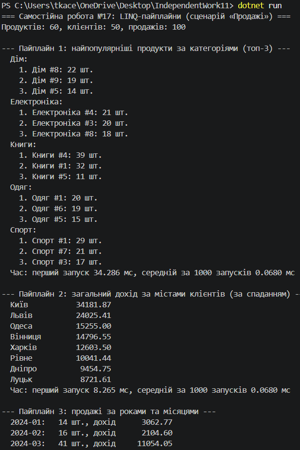
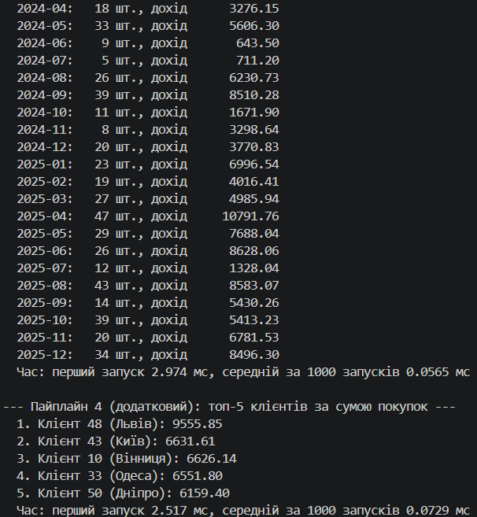

# Звіт із самостійної роботи №17

**З дисципліни:** Об'єктно-орієнтоване програмування
**Тема:** LINQ pipelines: ETL та аналітика
**Виконав:** студент Ткаченко Максим

## 1. Мета роботи

Розробити та проаналізувати складні LINQ-пайплайни для обробки даних, що імітують сценарії ETL (Extract, Transform, Load) та аналітики, використовуючи різні оператори LINQ.

## 2. Завдання

Сценарій «Продажі». Усі студенти виконують однаковий сценарій (індивідуальних варіантів немає).

**Сутності:**

- `Sale` (`Id`, `ProductId`, `Quantity`, `SaleDate`, `CustomerId`)
- `Product` (`Id`, `Name`, `Category`, `UnitPrice`)
- `Customer` (`Id`, `Name`, `City`)

**Обов'язкові пайплайни:**

1. Найпопулярніші продукти за категоріями (топ-3 у кожній категорії за кількістю).
2. Загальний дохід за містами клієнтів (за спаданням).
3. Продажі за місяцями та роками (кількість одиниць і дохід).

Додатково реалізовано **пайплайн 4**: топ-5 клієнтів за сумою покупок.

## 3. Структура проєкту

- `Models.cs`: сутності `Sale`, `Product`, `Customer` та типи результатів пайплайнів.
- `DataGenerator.cs`: псевдовипадкова генерація даних із фіксованим `Seed = 42` (60 продуктів у 5 категоріях, 50 клієнтів у 8 містах, 100 продажів за 2024–2025 роки).
- `Pipelines.cs`: кожен пайплайн оформлений окремим методом із промовистою назвою (`TopProductsByCategory`, `RevenueByCity`, `SalesByMonth`, `TopCustomers`).
- `Program.cs`: `Main` лише генерує дані, викликає пайплайни, вимірює час і виводить результати.
- `.gitignore`: виключає файли збірки (`bin/`, `obj/`) та системні файли.

## 4. Опис пайплайнів

### Пайплайн 1. Найпопулярніші продукти за категоріями

**Мета:** для кожної категорії знайти 3 продукти з найбільшою сумарною проданою кількістю.

**Кроки та оператори:**

1. `GroupBy(s => s.ProductId)` + `Sum(Quantity)`: сума проданих одиниць для кожного продукту.
2. `Join` із `Product`: отримання назви й категорії.
3. `GroupBy(Category)`: групування за категоріями.
4. `OrderByDescending(TotalQuantity).ThenBy(Id).Take(3)`: топ-3 у кожній групі. `ThenBy` потрібен для однозначного порядку, коли кількості збігаються.
5. `OrderBy(Category)` для стабільного порядку виводу.

**Чому так:** спочатку агрегуємо продажі до рівня «продукт» і лише потім з'єднуємо з довідником. Так `Join` працює з меншою кількістю рядків, ніж якби ми з'єднували кожен окремий продаж.

### Пайплайн 2. Загальний дохід за містами клієнтів

**Мета:** порахувати дохід кожного міста й упорядкувати міста за доходом від більшого до меншого.

**Кроки та оператори:**

1. `Join` продажів із продуктами: отримання `UnitPrice`, обчислення доходу продажу `Quantity * UnitPrice`.
2. `Join` із клієнтами: отримання міста.
3. `GroupBy(City)` + `Sum(Revenue)`: загальний дохід міста.
4. `OrderByDescending(Revenue)`: сортування за спаданням.

### Пайплайн 3. Продажі за місяцями та роками

**Мета:** для кожного місяця кожного року порахувати кількість проданих одиниць і загальний дохід.

**Кроки та оператори:**

1. `Join` продажів із продуктами: потрібна ціна, щоб порахувати дохід.
2. `GroupBy` за ключем `{ Year, Month }`.
3. `Select` + `Sum`: кількість одиниць і дохід кожної групи.
4. `OrderBy(Year).ThenBy(Month)`: хронологічний порядок.

### Пайплайн 4 (додатковий). Топ-5 клієнтів за сумою покупок

**Мета:** знайти клієнтів, які витратили найбільше.

**Кроки та оператори:** `Join` (ціни) → `GroupBy(CustomerId)` + `Sum` → `Join` (імена та міста) → `OrderByDescending` → `Take(5)`.

## 5. Вимірювання продуктивності

Для кожного пайплайну створюється новий `Stopwatch` (метод `Measure` у `Program.cs`). Вимірюється два значення:

- **перший запуск**: включає JIT-компіляцію й «холодний» кеш;
- **середній час за 1000 запусків**: показує реальну вартість самого пайплайну.

Пайплайни завершуються `ToList()`, тому час охоплює повне виконання, а не лише побудову запиту (LINQ виконується відкладено).

## 6. Результати виконання програми

Запуск: `dotnet run` у папці проєкту.


```text
=== Самостійна робота №17: LINQ-пайплайни (сценарій «Продажі») ===
Продуктів: 60, клієнтів: 50, продажів: 100

--- Пайплайн 1: найпопулярніші продукти за категоріями (топ-3) ---
  Дім:
    1. Дім #8: 22 шт.
    2. Дім #9: 19 шт.
    3. Дім #5: 14 шт.
  Електроніка:
    1. Електроніка #4: 21 шт.
    2. Електроніка #3: 20 шт.
    3. Електроніка #8: 18 шт.
  Книги:
    1. Книги #4: 39 шт.
    2. Книги #1: 32 шт.
    3. Книги #5: 11 шт.
  Одяг:
    1. Одяг #1: 20 шт.
    2. Одяг #6: 19 шт.
    3. Одяг #5: 15 шт.
  Спорт:
    1. Спорт #1: 29 шт.
    2. Спорт #7: 21 шт.
    3. Спорт #3: 17 шт.
  Час: перший запуск 34.286 мс, середній за 1000 запусків 0.0680 мс

--- Пайплайн 2: загальний дохід за містами клієнтів (за спаданням) ---
  Київ           34181.87
  Львів          24025.41
  Одеса          15255.00
  Вінниця        14796.55
  Харків         12603.50
  Рівне          10041.44
  Дніпро          9454.75
  Луцьк           8721.61
  Час: перший запуск 8.265 мс, середній за 1000 запусків 0.0680 мс

--- Пайплайн 3: продажі за роками та місяцями ---
  2024-01:   14 шт., дохід      3062.77
  2024-02:   16 шт., дохід      2104.60
  2024-03:   41 шт., дохід     11054.05
  2024-04:   18 шт., дохід      3276.15
  2024-05:   33 шт., дохід      5606.30
  2024-06:    9 шт., дохід       643.50
  2024-07:    5 шт., дохід       711.20
  2024-08:   26 шт., дохід      6230.73
  2024-09:   39 шт., дохід      8510.28
  2024-10:   11 шт., дохід      1671.90
  2024-11:    8 шт., дохід      3298.64
  2024-12:   20 шт., дохід      3770.83
  2025-01:   23 шт., дохід      6996.54
  2025-02:   19 шт., дохід      4016.41
  2025-03:   27 шт., дохід      4985.94
  2025-04:   47 шт., дохід     10791.76
  2025-05:   29 шт., дохід      7688.04
  2025-06:   26 шт., дохід      8628.06
  2025-07:   12 шт., дохід      1328.04
  2025-08:   43 шт., дохід      8583.07
  2025-09:   14 шт., дохід      5430.26
  2025-10:   39 шт., дохід      5413.23
  2025-11:   20 шт., дохід      6781.53
  2025-12:   34 шт., дохід      8496.30
  Час: перший запуск 2.974 мс, середній за 1000 запусків 0.0565 мс

--- Пайплайн 4 (додатковий): топ-5 клієнтів за сумою покупок ---
  1. Клієнт 48 (Львів): 9555.85
  2. Клієнт 43 (Київ): 6631.61
  3. Клієнт 10 (Вінниця): 6626.14
  4. Клієнт 33 (Одеса): 6551.80
  5. Клієнт 50 (Дніпро): 6159.40
  Час: перший запуск 2.517 мс, середній за 1000 запусків 0.0729 мс
  ```
### Скріншоти



### Таблиця вимірювань

| Пайплайн | Перший запуск, мс | Середній час (1000 запусків), мс |
|----------|-------------------|----------------------------------|
| 1. Топ-3 продуктів за категоріями | _заповнити_ | _заповнити_ |
| 2. Дохід за містами | _заповнити_ | _заповнити_ |
| 3. Продажі за місяцями | _заповнити_ | _заповнити_ |
| 4. Топ-5 клієнтів | _заповнити_ | _заповнити_ |

## 7. Аналіз результатів вимірювання

Які фактори могли вплинути на час виконання:

- **JIT-компіляція.** Перший запуск кожного пайплайну зазвичай помітно повільніший за середній, бо код компілюється під час першого виклику. Саме тому поряд із першим запуском вимірюється середній час.
- **Кількість операторів і проміжних колекцій.** Пайплайни з двома `Join` та `GroupBy` (№ 2 і № 4) виконують більше роботи, ніж пайплайни з одним `Join`.
- **Обсяг даних.** Для 100 продажів час вимірюється долями мілісекунди, тому різниця між пайплайнами невелика. На більших обсягах вона зростала б.
- **Порядок операторів.** Агрегація перед `Join` (пайплайн 1) зменшує кількість рядків, які з'єднуються.
- **Сортування.** `OrderBy`/`OrderByDescending` потребують повного проходу по даних. Ефект помітний на великих колекціях.
- **Виділення пам'яті.** Анонімні типи, групи та `ToList()` створюють об'єкти, що навантажує збирач сміття.
- **Стан системи.** Фонові процеси, режим живлення та кешування процесора впливають на вимірювання, тому одне коротке вимірювання ненадійне.

## 8. Висновки щодо ефективності LINQ для ETL та аналітичних завдань

1. LINQ дозволяє описати складну обробку даних (з'єднання, групування, агрегацію, сортування) декларативно, кількома рядками, замість вкладених циклів із тимчасовими словниками.
2. Кожен пайплайн читається як послідовність кроків «що зробити з даними», тому відповідає ETL-структурі: вибрати, перетворити, зібрати результат.
3. Для обсягів у сотні й тисячі записів продуктивність LINQ достатня, і різниця з ручними циклами для аналітики рідко має значення.
4. Продуктивність залежить від порядку операторів: фільтрувати й агрегувати варто якомога раніше, щоб `Join` і сортування працювали з меншою кількістю даних.
5. Перший запуск через JIT довший, тому для чесного порівняння потрібні повторні вимірювання.
6. Для дуже великих даних (мільйони записів) варто розглянути виконання на стороні бази даних (`IQueryable`/SQL) або паралельне виконання (PLINQ) і підтверджувати вибір профілюванням.

## 9. Відповіді на контрольні питання

1. **Які переваги дає LINQ для побудови ETL-пайплайнів порівняно з ручними циклами?**
   Код коротший і декларативний: видно, що відбувається з даними, а не як ітерувати. Оператори комбінуються в ланцюжок, кожен крок можна змінити чи додати окремо. Менше тимчасових змінних та помилок у ручному керуванні колекціями, є готові оператори (`Join`, `GroupBy`, `Sum`, `OrderBy`). Відкладене виконання дозволяє будувати запит поступово.
2. **Чому для аналітичних задач часто поєднують `Join`, `GroupBy`, `Select` та `OrderBy` в одному пайплайні?**
   Аналітична задача зазвичай складається з кількох етапів: зібрати дані з різних джерел (`Join`), згрупувати за потрібною ознакою (`GroupBy`), обчислити показники (`Select` з агрегатами) та впорядкувати результат для звіту (`OrderBy`). Один пайплайн дає ці етапи в одному виразі без проміжних структур, а результат одразу придатний для виводу.
3. **Які фактори можуть найбільше впливати на продуктивність складних LINQ-запитів?**
   Обсяг даних; порядок операторів (раннє фільтрування й агрегація); кількість `Join` та сортувань; створення проміжних колекцій і викликів `ToList()`; повторне перелічення відкладеного запиту; алокації пам'яті (анонімні типи, групи); JIT-компіляція при першому запуску; делегати й замикання в лямбдах.
4. **Як перевірити, що LINQ-пайплайн не лише працює, а й залишається читабельним і підтримуваним?**
   Виносити кожен пайплайн в окремий метод із промовистою назвою; обмежувати довжину ланцюжка й давати проміжним результатам імена; не змішувати в одному запиті декілька відповідальностей; перевіряти результат тестами на невеликих відомих даних; проходити код-рев'ю (чи зрозуміло колезі за хвилину, що робить запит); прибирати побічні ефекти з лямбд.

## Джерела

- [LINQ (Microsoft Docs)](https://learn.microsoft.com/dotnet/csharp/linq/)
- [LINQ Query Operations (Microsoft Docs)](https://learn.microsoft.com/dotnet/csharp/linq/standard-query-operators/)
- [ETL (Extract, Transform, Load), Wikipedia](https://en.wikipedia.org/wiki/Extract,_transform,_load)
